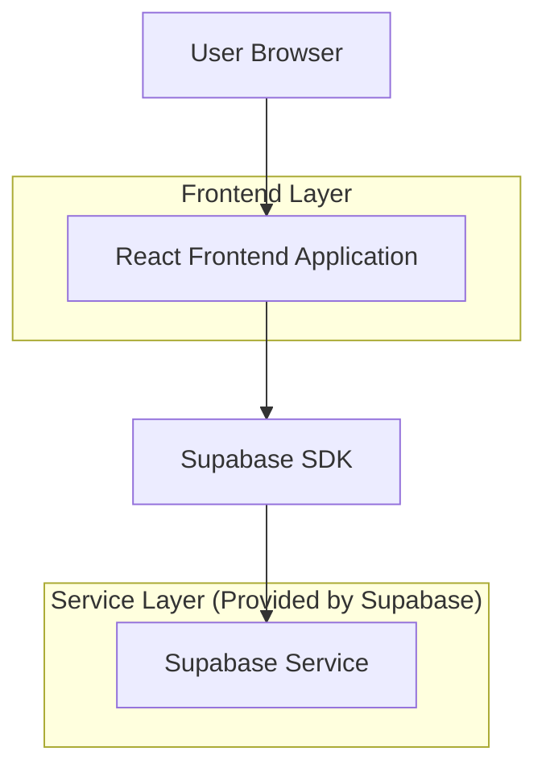
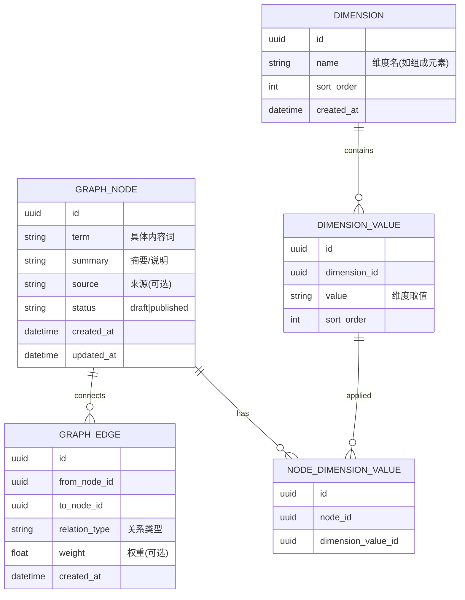

## 1.Architecture design


## 2.Technology Description
- Frontend: React@18 + vite + tailwindcss@3
- Backend: Supabase（Auth 可选；PostgreSQL 数据存储）
- Graph rendering: react-force-graph（或 Cytoscape.js 二选一，用于力导向/交互图谱）

## 3.Route definitions
| Route | Purpose |
|-------|---------|
| / | 知识网络首页：图谱展示、筛选、节点详情侧栏 |

## 6.Data model(if applicable)

### 6.1 Data model definition


### 6.2 Data Definition Language
Graph Nodes (graph_nodes)
```sql
CREATE TABLE graph_nodes (
  id UUID PRIMARY KEY DEFAULT gen_random_uuid(),
  term TEXT NOT NULL,
  summary TEXT,
  source TEXT,
  status TEXT DEFAULT 'published',
  created_at TIMESTAMPTZ DEFAULT NOW(),
  updated_at TIMESTAMPTZ DEFAULT NOW()
);
CREATE INDEX idx_graph_nodes_term ON graph_nodes (term);
```

Graph Edges (graph_edges)
```sql
CREATE TABLE graph_edges (
  id UUID PRIMARY KEY DEFAULT gen_random_uuid(),
  from_node_id UUID NOT NULL,
  to_node_id UUID NOT NULL,
  relation_type TEXT NOT NULL,
  weight REAL,
  created_at TIMESTAMPTZ DEFAULT NOW()
);
CREATE INDEX idx_graph_edges_from ON graph_edges (from_node_id);
CREATE INDEX idx_graph_edges_to ON graph_edges (to_node_id);
```

Dimensions (dimensions) & Values (dimension_values)
```sql
CREATE TABLE dimensions (
  id UUID PRIMARY KEY DEFAULT gen_random_uuid(),
  name TEXT NOT NULL,
  sort_order INT DEFAULT 0,
  created_at TIMESTAMPTZ DEFAULT NOW()
);

CREATE TABLE dimension_values (
  id UUID PRIMARY KEY DEFAULT gen_random_uuid(),
  dimension_id UUID NOT NULL,
  value TEXT NOT NULL,
  sort_order INT DEFAULT 0
);
CREATE INDEX idx_dimension_values_dimension ON dimension_values (dimension_id);
```

Node-Dimension mapping (node_dimension_values)
```sql
CREATE TABLE node_dimension_values (
  id UUID PRIMARY KEY DEFAULT gen_random_uuid(),
  node_id UUID NOT NULL,
  dimension_value_id UUID NOT NULL
);
CREATE INDEX idx_ndv_node ON node_dimension_values (node_id);
CREATE INDEX idx_ndv_value ON node_dimension_values (dimension_value_id);
```

Permissions (baseline)
```sql
GRANT SELECT ON graph_nodes TO anon;
GRANT SELECT ON graph_edges TO anon;
GRANT SELECT ON dimensions TO anon;
GRANT SELECT ON dimension_values TO anon;
GRANT SELECT ON node_dimension_values TO anon;

GRANT ALL PRIVILEGES ON graph_nodes TO authenticated;
GRANT ALL PRIVILEGES ON graph_edges TO authenticated;
GRANT ALL PRIVILEGES ON dimensions TO authenticated;
GRANT ALL PRIVILEGES ON dimension_values TO authenticated;
GRANT ALL PRIVILEGES ON node_dimension_values TO authenticated;
```