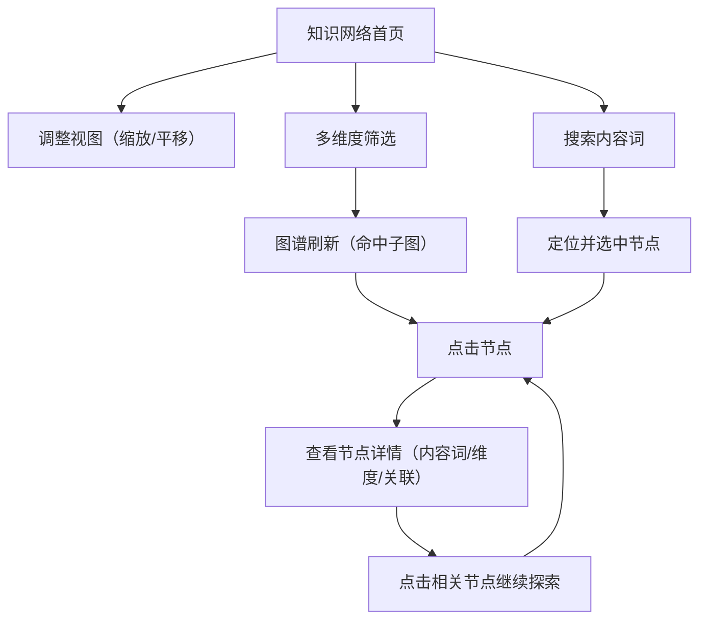

## 1. Product Overview
知识网络首页原型用于以“图谱”为核心承载知识点与关系探索，并通过多维度筛选快速聚焦你关心的主题。
面向需要做知识梳理/研究的用户，让节点直接呈现“具体内容词”，而不是抽象分类。

## 2. Core Features

### 2.1 Feature Module
本原型的需求由以下页面构成：
1. **知识网络首页**：大图谱展示、多维度筛选、节点内容词展示、节点详情与关系浏览。

### 2.3 Page Details
| Page Name | Module Name | Feature description |
|-----------|-------------|---------------------|
| 知识网络首页 | 顶部栏（基础导航） | 显示产品名称；提供全局搜索入口（按节点内容词搜索）；提供重置视图/重置筛选按钮。 |
| 知识网络首页 | 图谱主视图（占比更大） | 展示节点与边；支持缩放/平移；支持按当前筛选条件实时刷新；节点标签显示“具体内容词”（如术语/概念/实体名），不显示抽象分类名。 |
| 知识网络首页 | 多维度筛选面板 | 按多维度筛选（如“组成元素/来源/主题/时间”等维度，维度名称可配置）；支持多选；展示已选筛选条件（可一键清空某一维度）。 |
| 知识网络首页 | 图谱图例与统计 | 展示颜色/形状与维度映射的图例；展示当前命中节点数/边数。 |
| 知识网络首页 | 节点详情侧栏/弹层 | 点击节点后展示：内容词标题、摘要/说明、所属维度取值、相关节点列表（可点击跳转）、关系类型列表。 |
| 知识网络首页 | 关系浏览与高亮 | 悬停/选中节点时高亮其一跳邻居与相关边；支持“仅看选中节点子图/返回全图”。 |

## 3. Core Process
- 探索流程：你进入首页后，先通过缩放/拖拽查看整体结构；再用筛选面板选择多维度条件缩小范围；最后点击某个节点查看其具体内容词与关联关系，并继续沿关系跳转探索。
- 定向查找流程：你在顶部搜索框输入内容词，定位并选中对应节点；根据节点详情中的维度与相关节点继续筛选/探索。

