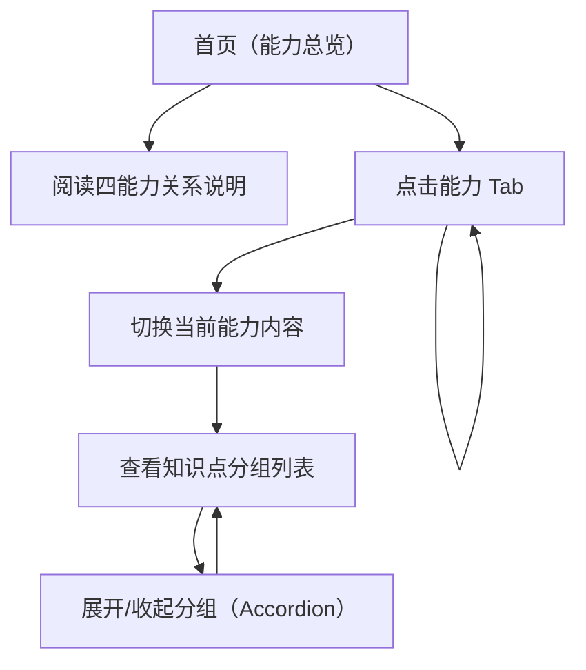

## 1. Product Overview
以白色极简风格重构一个单页网站，在首页清晰解释“四种能力”的关系，并通过 Tab 切换查看各能力下的知识点列表。
面向想快速理解能力体系与学习路径的访客，交互保持简单直观。

## 2. Core Features

### 2.1 Feature Module
本网站的需求由以下页面构成：
1. **首页（能力总览）**：四能力关系说明、能力 Tab 切换、知识点列表展开/收起。

### 2.3 Page Details
| Page Name | Module Name | Feature description |
|-----------|-------------|---------------------|
| 首页（能力总览） | 顶部导航 | 显示网站名称；提供页面内导航（如“能力关系”“知识点”锚点）。 |
| 首页（能力总览） | 四能力关系说明 | 解释四种能力各自定义；展示四者关系（文字说明 + 简单关系示意）。 |
| 首页（能力总览） | 能力 Tab 切换 | 提供 4 个 Tab；点击后切换当前能力视图，并在同一页面更新知识点列表内容。 |
| 首页（能力总览） | 知识点列表（可展开） | 展示当前能力对应知识点分组与条目；支持展开/收起分组（Accordion）；展开后显示知识点标题与简短说明。 |
| 首页（能力总览） | 内容状态与空态 | 首次进入默认选中一个能力；无数据时显示“暂无知识点”提示。 |
| 首页（能力总览） | 页脚 | 显示简单版权信息/联系入口（仅展示，不引入额外流程）。 |

## 3. Core Process
- 浏览理解流程：你进入首页后先阅读“四能力关系说明”，建立整体心智模型；然后通过 Tab 切换到某个能力；在该能力下展开知识点分组，查看各知识点的简短说明。
- 对比查看流程：你在不同 Tab 之间来回切换，以同样的列表结构对比四种能力的知识点组成。

