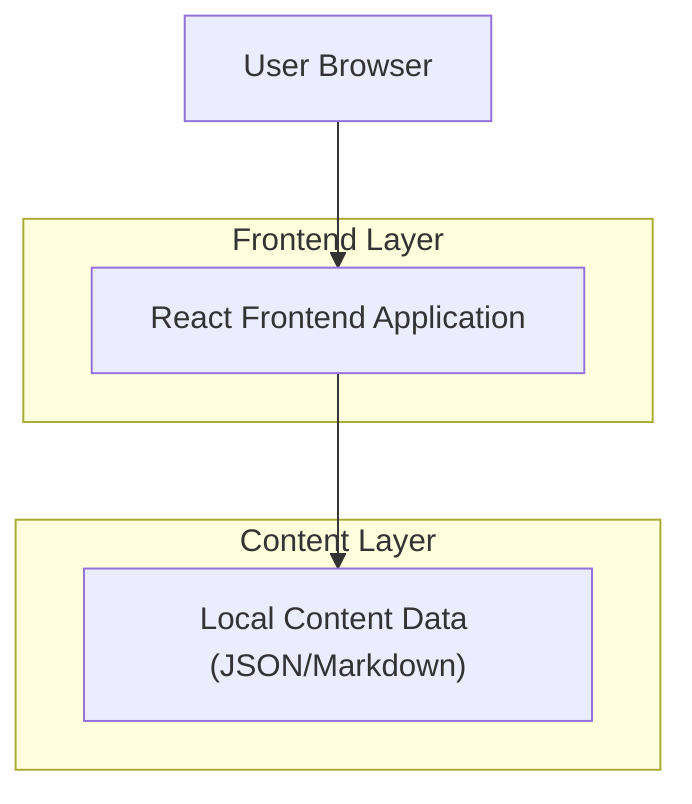

## 1.Architecture design

## 2.Technology Description
- Frontend: React@18 + vite + tailwindcss@3
- Backend: None
- Content: 本地静态数据（JSON 或 Markdown 编译为 JSON），用于承载“四能力定义 + 各能力知识点列表”

## 3.Route definitions
| Route | Purpose |
|-------|---------|
| / | 首页：四能力关系说明、Tab 切换、知识点列表展开/收起 |
